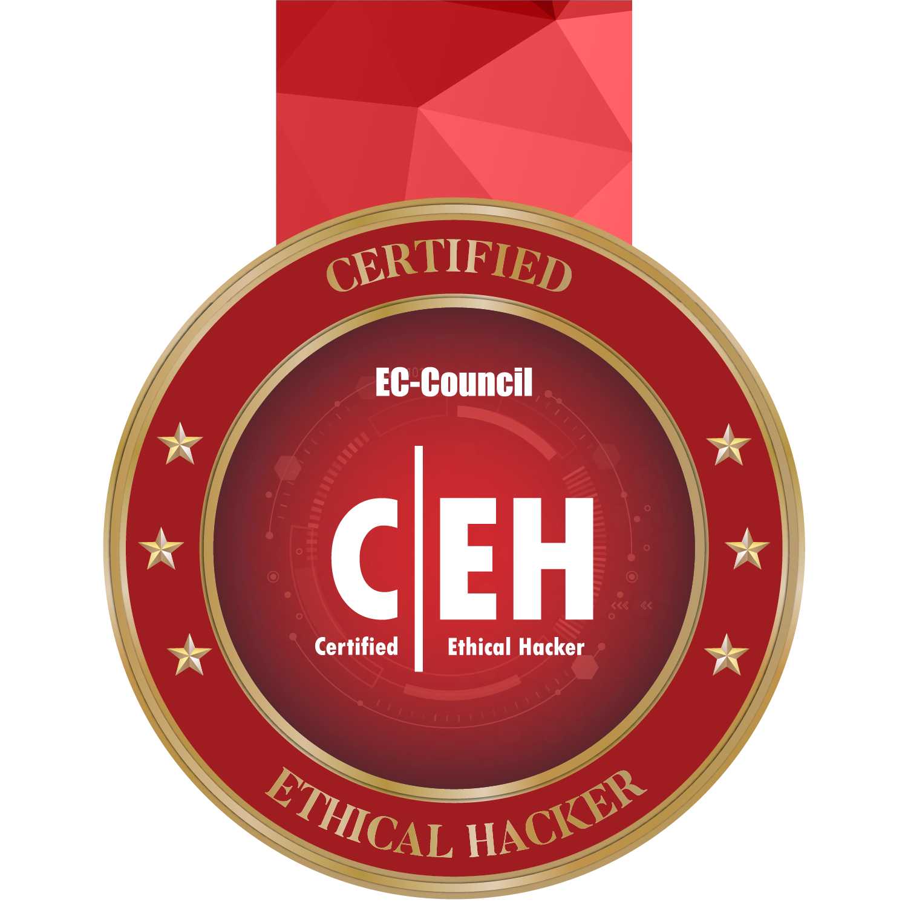
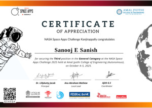
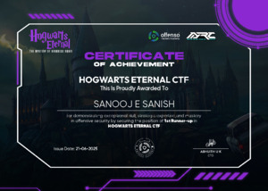

<h1><strong>Hi there! I'm Sanooj Es 👋</strong></h1>

<strong>I'm a full-stack developer and ethical hacker (CEH). I write code in Typescript, Python, Rust and C, and I do penetration testing and random projects.</strong>

<h2>Certifications</h2>

<table width="100%" style="max-width: 580px; border-collapse: separate; border-spacing: 0; border: 1px solid #303030; border-radius: 14px; overflow: hidden; margin-bottom: 16px;">
<tr>
<td valign="middle" style="padding: 12px 16px;">
<b>Certified Ethical Hacker (CEH v13)</b> 

EC-Council
 
 &nbsp; 
</td>
<td width="116" align="center" valign="middle" style="padding: 0 12px 12px 12px; border-left: 1px solid #303030;">

</td>
</tr>
</table>

<h2>Achievements</h2>

<table width="100%" style="max-width: 580px; border-collapse: separate; border-spacing: 0; border: 1px solid #303030; border-radius: 14px; overflow: hidden; margin-bottom: 16px;">
<tr>
<td valign="middle" style="padding: 12px 16px;">
<b>NASA Space Apps Challenge 2025 - 3rd Place</b> 
Amal Jyothi College of Engineering Autonomous 
Oct 2025 
 
</td>
<td width="133" align="center" valign="middle" style="padding: 0 12px 12px 12px; border-left: 1px solid #303030;">

</td>
</tr>
</table>

<table width="100%" style="max-width: 580px; border-collapse: separate; border-spacing: 0; border: 1px solid #303030; border-radius: 14px; overflow: hidden; margin-bottom: 16px;">
<tr>
<td valign="middle" style="padding: 12px 16px;">
<b>HOGWARTS ETERNAL CTF - 1st Runner Up</b> 
Offenso Academy 
2025
</td>
<td width="133" align="center" valign="middle" style="padding: 0 12px 12px 12px; border-left: 1px solid #303030;">

</td>
</tr>
</table>

<h2>Skills & Expertise</h2>

<strong>Languages</strong>

<strong>Frameworks & Runtimes</strong>

<strong>Databases</strong>

<strong>Cybersecurity & Infrastructure</strong>

<h2>Connect with Me</h2>

<h2>GitHub Telemetry</h2>

  
  
  
  

<h2>Contribution Graph</h2>

<picture>
  <source media="(prefers-color-scheme: dark)" srcset="./assets/generated/github-snake-dark.svg" />
  <source media="(prefers-color-scheme: light)" srcset="./assets/generated/github-snake.svg" />
  
</picture>

<h2>Live Presence</h2>

  

<h2>Support My Work</h2>

If you find my project helpful, consider supporting its development:

  
  &nbsp;
  

