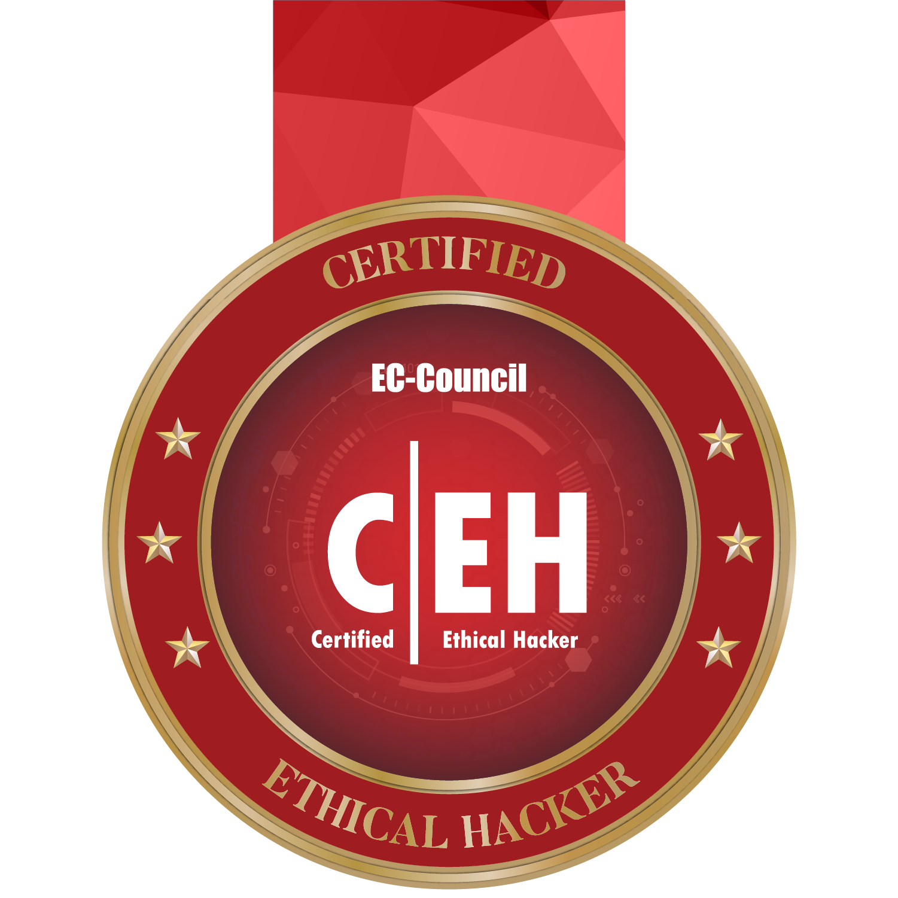
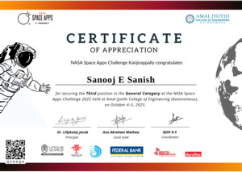
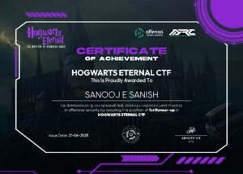
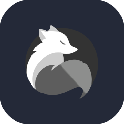

<h1>Hi, I'm Sanooj E Sanish 👋</h1>

<strong>I'm a full-stack developer and ethical hacker (CEH). I write code in Typescript, Python, Rust and C, and I do penetration testing and random projects.</strong>

<h2>Credentials &amp; Honors</h2>

<table>
  <thead>
    <tr>
      <th width="120" align="center">Badge</th>
      <th width="580" align="left">Credential</th>
      <th width="200" align="center">Verification</th>
    </tr>
  </thead>
  <tbody>
    <tr>
      <td width="120" align="center" valign="middle">
        
      </td>
      <td width="580" valign="middle">
        <b>Certified Ethical Hacker (CEH v13)</b>
         EC-Council
      </td>
      <td width="200" align="center" valign="middle">
         
        
      </td>
    </tr>
    <tr>
      <td width="120" align="center" valign="middle">
        
      </td>
      <td width="580" valign="middle">
        <b>NASA Space Apps Challenge 2025 - 3rd Place</b>
         Amal Jyothi College of Engineering Autonomous · Oct 2025
      </td>
      <td width="200" align="center" valign="middle">
         
        
      </td>
    </tr>
    <tr>
      <td width="120" align="center" valign="middle">
        
      </td>
      <td width="580" valign="middle">
        <b>HOGWARTS ETERNAL CTF - 1st Runner Up</b>
         Offenso Academy · 2025
      </td>
      <td width="200" align="center" valign="middle">
        
      </td>
    </tr>
  </tbody>
</table>

<h2>Tech Stack &amp; Tooling</h2>

<table>
  <thead>
    <tr>
      <th width="450" align="left">Languages</th>
      <th width="450" align="left">Frameworks &amp; Runtimes</th>
    </tr>
  </thead>
  <tbody>
    <tr>
      <td width="450" valign="middle">
        
        
        
        
        
        
        
        
      </td>
      <td width="450" valign="middle">
        
        
        
        
        
        
      </td>
    </tr>
    <tr>
      <th width="450" align="left">Databases</th>
      <th width="450" align="left">Cybersecurity &amp; Infrastructure</th>
    </tr>
    <tr>
      <td width="450" valign="middle">
        
        
        
      </td>
      <td width="450" valign="middle">
        
        
        
        
        
      </td>
    </tr>
  </tbody>
</table>

<h2>Coding Activity &amp; Telemetry</h2>

  <a href="https://github.com/sanoojes">
    <picture>
      <source media="(prefers-color-scheme: dark)" srcset="https://github-profile-summary-cards.vercel.app/api/cards/profile-details?username=sanoojes&theme=github_dark&animation=load&name=Sanooj+E+Sanish&bg_color=0e0e0e&border_color=303030" />
      <source media="(prefers-color-scheme: light)" srcset="https://github-profile-summary-cards.vercel.app/api/cards/profile-details?username=sanoojes&theme=default&animation=load&name=Sanooj+E+Sanish" />
      
    </picture>
  </a>
  <a href="https://github.com/sanoojes">
    <picture>
      <source media="(prefers-color-scheme: dark)" srcset="https://github-profile-summary-cards.vercel.app/api/cards/stats?username=sanoojes&theme=github_dark&animation=load&bg_color=0e0e0e&border_color=303030" />
      <source media="(prefers-color-scheme: light)" srcset="https://github-profile-summary-cards.vercel.app/api/cards/stats?username=sanoojes&theme=default&animation=load" />
      
    </picture>
  </a>
   
  <a href="https://github.com/sanoojes">
    <picture>
      <source media="(prefers-color-scheme: dark)" srcset="https://github-profile-summary-cards.vercel.app/api/cards/most-commit-language?username=sanoojes&theme=github_dark&animation=load&bg_color=0e0e0e&border_color=303030" />
      <source media="(prefers-color-scheme: light)" srcset="https://github-profile-summary-cards.vercel.app/api/cards/most-commit-language?username=sanoojes&theme=default&animation=load" />
      
    </picture>
  </a>
  <a href="https://hackatime.hackclub.com">
    <picture>
      <source media="(prefers-color-scheme: dark)" srcset="https://github-readme-stats.hackclub.dev/api/wakatime?username=23888&api_domain=hackatime.hackclub.com&theme=github_dark&custom_title=Hackatime+Stats&layout=compact&cache_seconds=0&langs_count=8&bg_color=0E0E0E&border_radius=10&border_color=303030" />
      <source media="(prefers-color-scheme: light)" srcset="https://github-readme-stats.hackclub.dev/api/wakatime?username=23888&api_domain=hackatime.hackclub.com&theme=default&custom_title=Hackatime+Stats&layout=compact&cache_seconds=0&langs_count=8&border_radius=10" />
      
    </picture>
  </a>
   
  <picture>
    <source media="(prefers-color-scheme: dark)" srcset="./assets/generated/github-snake-dark.svg" />
    <source media="(prefers-color-scheme: light)" srcset="./assets/generated/github-snake.svg" />
    
  </picture>

<h2>Live Status</h2>

  <a href="https://sanooj.uk/discord" target="_blank" rel="noopener noreferrer">
    <picture>
      <source media="(prefers-color-scheme: dark)" srcset="https://lanyard.cnrad.dev/api/821653196161679371?bg=0E0E0E&borderRadius=10px" />
      <source media="(prefers-color-scheme: light)" srcset="https://lanyard.cnrad.dev/api/821653196161679371?theme=light&bg=ffffff&borderRadius=10px" />
      
    </picture>
  </a>

<h2>Connect</h2>

  &nbsp;&nbsp;
  &nbsp;&nbsp;
  &nbsp;&nbsp;
  

<h2>Support My Work</h2>

If you find my projects helpful, consider supporting their development:

  &nbsp;
  

